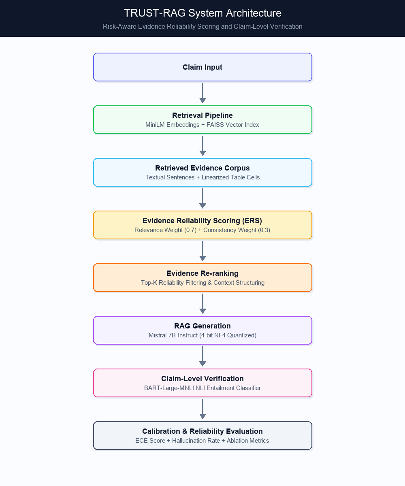

# TRUST-RAG

## Risk-Aware Evidence Reliability Scoring and Claim-Level Verification for RAG

TRUST-RAG is an empirical framework for improving the reliability of Retrieval-Augmented Generation systems through evidence reliability scoring, evidence re-ranking, and claim-level verification.

The framework is empirically evaluated on the **FEVEROUS** benchmark, which contains both textual and structured/table evidence.

The experiments compare TRUST-RAG against an LLM-only baseline and a standard RAG pipeline, with additional analysis of retrieval performance, hallucination, calibration, and component ablations.

---

## Architecture



---

## Methodology

TRUST-RAG evaluates a retrieval-augmented generation pipeline through four major stages:

1. **Evidence Retrieval**: Hybrid evidence retrieval across unstructured text and structured tables using MiniLM embeddings (`all-MiniLM-L6-v2`) and a FAISS vector index.
2. **Evidence Reliability Scoring (ERS) & Re-ranking**: Scores retrieved evidence items by combining relevance weighting ($w_{relevance} = 0.7$) and consistency weighting ($w_{consistency} = 0.3$) to re-rank Top-K evidence prior to context construction.
3. **Claim-Level Verification**: Uses Natural Language Inference (BART-Large-MNLI) to verify claim entailment and compute fine-grained hallucination metrics.
4. **Calibration & Reliability Evaluation**: Assesses Expected Calibration Error (ECE), label verification accuracy, and component ablations.

---

## Results

Empirical results evaluated on the 450-claim FEVEROUS validation benchmark:

| Metric | LLM-only (B1) | Standard RAG (B2) | TRUST-RAG (Proposed) |
|---|---:|---:|---:|
| **Label Verification Accuracy** | 38.89% | 43.78% | **46.00%** |
| **Retrieval Recall@10** | — | 64.86% | **64.86%** |
| **Retrieval Recall@5** | — | 59.36% | **59.36%** |
| **Hallucination Rate ($\tau_g = 0.5$)** | 82.22% | 83.78% | **85.33%** |
| **Expected Calibration Error (ECE)** | — | 0.2512 | **0.2881** |

*All metrics trace directly to structured evaluation outputs in `outputs/metrics_summary.json`.*

---

## Project Structure

```text
trust-rag/
├── README.md                           ← Project documentation
├── LICENSE                             ← MIT License
├── .gitignore                          ← Git ignore configuration
│
├── 01_Data_Preparation.ipynb           ← Install dependencies, load FEVEROUS, build dataset
├── 02_Retrieval_Pipeline.ipynb        ← MiniLM embeddings, FAISS index, Precision/Recall@K
├── 03_Baselines.ipynb                 ← Baseline 1 (LLM-only) & Baseline 2 (Standard RAG)
├── 04_Evidence_Scoring.ipynb          ← Evidence Reliability Scoring (ERS) & Re-ranking
├── 05_Claim_Verification.ipynb        ← NLI entailment verification & hallucination metrics
├── 06_Calibration_and_Ablation.ipynb    ← Calibration (ECE), ablation runs, and plots
├── 07_Analysis_and_Results.ipynb      ← Summary metrics, error analysis, paper tables
│
├── figures/                            ← Generated plots and diagrams
│   ├── trust-rag-architecture.png
│   ├── fig5_1_label_accuracy.png
│   ├── fig5_2_retrieval.png
│   ├── fig5_4_hallucination.png
│   ├── fig5_5_calibration.png
│   └── fig5_6_ablation.png
│
├── outputs/                            ← Runtime output data & evaluation JSON/CSVs
│   ├── retrieval_results.csv
│   ├── b1_outputs.csv
│   ├── b2_outputs.csv
│   ├── proposed_outputs.csv
│   ├── verification_results.csv
│   └── metrics_summary.json
│
└── data/                               ← Processed dataset files
    ├── claims.json
    └── evidence_corpus.json
```

---

## Environment & Requirements

| Component | Specification |
|---|---|
| **Runtime Environment** | Google Colab (T4 GPU) / Local Python 3.10+ |
| **Embedding Model** | `all-MiniLM-L6-v2` |
| **Vector Index** | `faiss-cpu` (IndexFlatIP, Cosine similarity) |
| **LLM Generator** | `mistralai/Mistral-7B-Instruct-v0.3` (4-bit NF4 quantized) |
| **NLI Verifier** | `facebook/bart-large-mnli` |
| **Benchmark Dataset** | FEVEROUS (`fever/feverous`) |

---

## Quick-Start (Google Colab)

1. Upload notebooks `01_Data_Preparation.ipynb` through `07_Analysis_and_Results.ipynb` to Google Drive / Colab.
2. Select **T4 GPU** runtime in Google Colab (`Runtime -> Change runtime type -> T4 GPU`).
3. Run **`01_Data_Preparation.ipynb`** to generate the frozen claims and evidence corpus in `data/`.
4. Run remaining notebooks `02` through `07` in numerical order.

---

## Dataset Citation

```bibtex
@inproceedings{feverous2021,
  title     = {FEVEROUS: Fact Extraction and VERification Over Unstructured and Structured information},
  author    = {Aly, Rami and Guo, Zhiwei and Schlichtkrull, Michael Sejr and Thorne, James and Vlachos, Andreas and Christodoulopoulos, Christos and Cocarascu, Oana and Mittal, Arpit},
  booktitle = {Proceedings of the Neural Information Processing Systems Track on Datasets and Benchmarks},
  year      = {2021}
}
```

---

## License

This project is licensed under the [MIT License](LICENSE).
